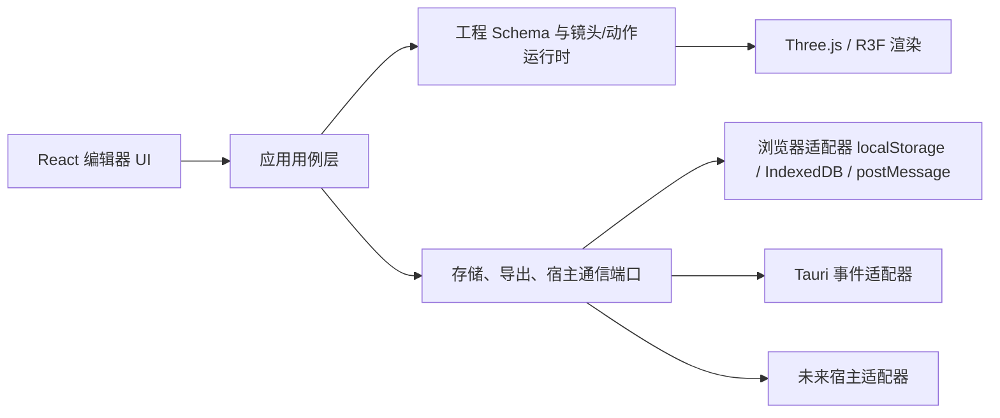

# 3D 导演台二开主实施方案

状态：**已确认，分阶段实施中**

制定日期：2026-08-02

当前基线：`xiaozangao/3d-director-desk` `main@a6c931cd36d8263d986706f74ab4efe9d5151959`

首个二开发行候选：`v0.4.0`

## 1. 目标与边界

### 1.1 已确认目标

- 以 `xiaozangao/3d-director-desk` 为上游进行二次开发。
- 保留轻量浏览器 3D 预演、镜头路线、人物运动、帧/视频导出和二创接口等现有能力。
- 保持项目独立，通过稳定适配器与宿主集成，不把 Three.js/R3F 依赖直接并入宿主仓库。
- 每个阶段必须可独立验收、可回退，不以大范围重写替代渐进演进。

### 1.2 本方案不擅自决定的事项

- 产品品牌、商业模式、账号体系、云同步、团队协作、素材版权采购和生产部署目标。
- 是否正式交付 Tauri 桌面安装包；当前仓库只有 Tauri 事件适配器，没有 `src-tauri` 宿主工程。
- 是否与 ICA、无限画布或其他产品做具体集成；此类跨项目动作需要单独授权和双端验收。

## 2. 当前事实审计

### 2.1 已有能力

- React 18 + TypeScript + Vite 6 + Three.js/R3F + Zustand，Node.js 要求 `>=20`。
- 浏览器本地多导演台、工程 JSON 导入导出、本地模型/动作/全景图、IndexedDB 二进制存储。
- 镜头与人物统一时间轴、动作与身体部位跟踪、帧导出、MP4 参考视频导出。
- iframe `postMessage` 协议 v1、工程 schema v1、受控插件结果和 Tauri 事件传输适配器。
- 87 个 Vitest 测试文件、686 项测试；当前基线测试与生产构建均通过。

### 2.2 主要缺口

| 缺口 | 当前证据 | 影响 |
| --- | --- | --- |
| 安全依赖 | `postcss@8.5.15` 命中 1 个 high 漏洞 | 开发/构建链存在路径遍历风险 |
| 架构热点 | `directorStore.ts` 约 3065 行，多个渲染组件超过 1200 行 | 改动冲突、回归和理解成本高 |
| 质量门禁 | 有单测和构建，无独立 lint、类型检查脚本和浏览器 E2E 门禁 | UI/协议真实行为主要靠人工复验 |
| 可移植性 | 工程 JSON 只引用浏览器本地大素材 | 跨设备恢复需要重新导入素材 |
| 宿主边界 | iframe 与 Tauri 共用消息语义，但缺少统一 transport 接口和版本协商状态机 | 扩展新宿主时容易复制逻辑 |
| 桌面交付 | 只有 Tauri JS 事件层，没有可构建宿主、签名和更新链路 | 不能宣称已有桌面应用 |
| 发布治理 | 推送 `main` 会自动部署 Pages，tag 会发布静态包 | 二开仓库建立前不能直接沿用发布动作 |
| 性能资产 | Three.js 构建块约 734 KB，高斯实验块约 4.97 MB；公开资产约 73 MB | 首次加载、缓存和再分发审计压力较大 |

### 2.3 2026-08-02 实施进展快照

- 安全审计已清零，统一 CI/本地质量门禁已建立。
- `directorStore.ts` 的持久化和 hydration 已拆到独立模块；抽取完成时主文件从约 3065 行降至 2760 行，加入后续镜头能力后当前为 2848 行；schema、storage key 和公开 store API 保持不变。
- 工程顶部已显示 JSON 可移植性，并真实核对 IndexedDB 本地素材引用是否缺失。
- iframe 与 Tauri 已接入统一 `DirectorHostTransport` 路由，协议仍为 v1。
- 镜头支持直接复制，复制件保留独立轨迹但不复制截图；镜头改名与场景树同步。
- 构建体积预算已进入 `npm run verify`；候选发布资产门禁已建立并因许可证据不足而失败关闭。

## 3. 产品路线选择

| 方案 | 说明 | 收益 | 代价/风险 |
| --- | --- | --- | --- |
| A. 独立核心优先（推荐） | 浏览器导演台保持独立，iframe/Tauri 作为适配器 | 上游兼容最好，可服务多个宿主，回退简单 | 需要维护稳定契约和独立发布 |
| B. 宿主嵌入优先 | 围绕某一个宿主定制 UI、存储和流程 | 单一集成体验可更深 | 跨仓库耦合高，容易失去独立升级能力 |
| C. 桌面端优先 | 先补齐完整 Tauri 宿主、文件系统和安装包 | 本地大素材与导出体验更强 | 签名、自动更新、权限和跨平台验收成本最高 |

本方案按 **A** 设计：核心保持独立；B、C 都通过适配层进入，不反向污染领域模型。

## 4. 目标架构



核心原则：

1. `DirectorProject` 是可持久化权威数据；选择状态、播放循环和操作手柄属于 UI/运行时状态。
2. 镜头、人物、主视口、监看和导出只使用一个时间源及一套姿态/跟踪计算。
3. transport 只搬运版本化消息，不直接操作 UI 组件。
4. 本地大素材使用稳定引用；任何可移植包必须显式声明是否包含二进制和第三方许可。
5. v1 协议与 schema 保持可读；破坏性变化只能进入新版本并提供单向迁移。

## 5. 分阶段实施

### 阶段 0：二开基线与治理（已完成）

范围：独立 checkout、`upstream` 远端、工作分支、项目规则、状态、历史、基线测试和浏览器首页验证。

验收：

- Git 根、远端、分支与基线提交可追溯。
- `npm ci`、`npm test`、`npm run build` 通过。
- 本地首页能真实渲染且控制台无 warning/error。

### 阶段 1：安全与质量门禁（已完成）

目标：在不改变产品行为和公共协议的前提下，建立可信二开入口。

拟改：

- `package-lock.json`：把 `postcss` 升到已修复且满足现有 Vite 范围的版本。
- `package.json`：增加明确的 `typecheck`、`test:ci`、`audit:high`、`verify` 脚本；不升级无关直接依赖。
- `.github/workflows/ci.yml`：只做安装、审计、测试、类型检查和构建，不部署。
- `.github/workflows/pages.yml`、`release.yml`：在建立我们自己的远端与发布授权前保持不触发或增加显式发布门禁，具体策略确认后实施。
- 必要的测试配置与文档。

兼容性：不改运行时、工程数据或嵌入协议。

回退：恢复 `package.json`、锁文件和新增 CI 文件即可；业务数据不受影响。

验收：

- `npm audit --audit-level=high` 无 high/critical。
- 686 项既有测试全部通过；类型检查和生产构建通过。
- 锁文件差异只包含预期安全升级。

完成记录：

- `postcss` 从 `8.5.15` 升级到 `8.5.25`，随其依赖声明将 `nanoid` 从 `3.3.12` 升级到 `3.3.16`；未升级直接依赖。
- 新增 `test:ci`、`typecheck`、`audit:high`、`verify` 脚本和只验证、不部署的 `.github/workflows/ci.yml`。
- 本地统一门禁通过：0 漏洞、87 个测试文件、686 项测试、类型检查和生产构建全部成功。
- 首页及独立编辑器实例浏览器回归通过，控制台无 warning/error。

### 阶段 2：架构热点拆分（进行中，首批已完成）

目标：降低后续功能二开的回归半径，不改公共行为。

拟改：

- 将 `directorStore.ts` 拆为 `persistence`、`history`、`project`、`selection`、`assets`、`motion` 等内部模块或 slice 工厂。
- 将 `DirectorCanvas.tsx` 的截图/视频导出、摄像机控制和监看编排拆到应用服务与专用组件。
- 将 `SceneRoot.tsx` 的模型解析、场景对象渲染和运行时采样拆成稳定边界。
- 保留 `useDirectorStore`、现有组件入口、协议类型和 schema 导出路径。

数据影响：无 schema 变更；localStorage/IndexedDB key 不变。

回退：按子模块逐批提交；任一批可独立回退，不合并跨批重写。

验收：

- 既有 686 项测试全绿，并为每次抽取补充等价性测试。
- 浏览器完成首页、打开导演台、对象编辑、运镜预演和导出入口 smoke。
- 公共导出和持久化快照保持兼容。

首批完成记录：

- 新增 `directorStore.persistence.ts`，集中管理 storage scope、key、本地素材元数据和快照读写。
- 新增 `directorStore.hydration.ts`，集中管理默认状态、v0/v1 迁移、规范化和持久化快照 hydration。
- 增加持久化等价性测试；全量测试和刷新恢复通过，storage key、schema 与 `useDirectorStore` 入口未变。
- 抽取完成时 `directorStore.ts` 从约 3065 行降至 2760 行；加入后续镜头能力后当前为 2848 行。history、assets、motion、`DirectorCanvas` 与 `SceneRoot` 后续批次仍待拆分。

### 阶段 3：工程可靠性与可移植性（进行中，健康检查已完成）

目标：让用户明确知道工程是否完整、能否跨设备恢复，并避免素材孤儿。

拟改：

- 引入工程健康检查：缺失本地素材、不可解析模型、未来 schema、存储配额失败给出明确状态。
- 增加可移植性清单与“仅工程 JSON / 工程加素材包”两种导出策略设计。
- 若实施素材包，定义 manifest、哈希、大小上限、许可清单和导入事务；不在 schema v1 内偷偷添加不兼容语义。
- 增加删除导演台时的关联二进制清理预览与可恢复确认，不静默删除共享素材。

数据影响：工程健康检查无数据迁移；素材包功能若确认，新增独立包格式或 schema v2 迁移。

回退：新格式只作为可选导入/导出入口；现有 JSON 和浏览器数据继续可用。

验收：

- v0、v1、损坏文件和未来版本均有确定性测试。
- 含/不含本地素材的工程都能显示准确可移植性状态。
- 导入失败不覆盖当前工程；成功后刷新仍能恢复。

首批完成记录：

- 抽出统一 `getDirectorProjectPortability`，扩展协议与 UI 使用同一事实来源。
- 顶部常驻显示“JSON 可跨设备”“含 N 个本地素材”“缺失 N 个素材”或“无法检查本地素材”。
- 对 storage key、稳定本地 URL 和临时 blob URL 建立确定性检查；IndexedDB 不可用与文件缺失不混为一谈。
- 工程素材包格式、配额写入探测和删除导演台的共享素材清理预览仍待后续批次；本轮不改 schema v1。

### 阶段 4：宿主协议与适配器产品化（本地状态机与 iframe 契约已完成）

目标：让 iframe、Tauri 和未来宿主共享一套应用命令与响应语义。

拟改：

- 抽象 `DirectorHostTransport`，分离 origin 校验、消息解析、命令执行和响应发送。
- 保持协议 v1 行为，新增能力协商、运行状态和可取消任务时优先采用向后兼容字段；确需破坏性变化时才提 v2。
- 对 `instanceId`、`hostOrigin`、请求并发、超时、导出取消和宿主断开建立状态机测试。
- 提供独立可运行的宿主契约 smoke；具体宿主仓库集成另行授权。

数据影响：默认无工程 schema 变化；协议只做加法兼容。

回退：保留现有 `hostBridge` v1 路径直到新适配器完成等价验收。

验收：

- 错误来源、错误 origin、错误 instance、重复 requestId 和并发导出全部 fail closed。
- iframe 与模拟 Tauri 传输跑同一组契约测试。
- v1 宿主示例无需修改即可继续工作。

首批完成记录：

- 新增统一 `DirectorHostTransport` 与路由器，Tauri 优先、`postMessage` 安全回退。
- origin/source 校验和 `postMessage` 解析进入专用适配器；Tauri 继续校验 `instanceId`。
- 原有 20 项 host bridge 测试及新增 transport 契约测试通过；协议与工程 schema 均保持 v1。
- 已完成重复/冲突 `requestId` 防重、内部超时、显式取消、宿主断开、ICA Capability 续期失败锁定与新会话恢复；导出任务全链路消费 `AbortSignal`。
- 独立可运行 iframe smoke 已真实覆盖取消、防重、三帧导出、时间线恢复、插件查询和断开回首页。
- 真正 Tauri 壳与 ICA 远程目标环境的双宿主 E2E 仍待后续授权环境验收。

### 阶段 5：创作工作流增强（进行中，镜头复制已完成）

目标：把现有功能整理成更快完成“场景 → 运镜 → 预演 → 导出”的工作流。

候选范围（需产品确认后排优先级）：

- 新建导演台向导与可复用场景/镜头模板。
- 工程健康与未保存/不可移植状态常驻提示。
- 镜头列表、批量命名、复制镜头和导出队列。
- 更明确的素材缺失、浏览器能力不足和导出失败恢复路径。
- 只保留普通用户需要的默认 UI，高级参数进入渐进式面板。

兼容性：优先复用现有 schema 字段；新增持久化字段必须提供默认值、迁移和回退。

验收：

- 新用户可在不阅读文档的情况下完成首条镜头并导出。
- 旧工程打开、编辑、导出结果不回归。
- 关键路径完成桌面浏览器真实操作验收，不以组件测试代替。

首批完成记录：

- 镜头属性面板新增“复制当前镜头”；复制轨迹时重新生成轨迹点 ID，截图不随复制件重复存储。
- 镜头改名会同步关联的场景树摄像机对象，修复此前两处名称不一致。
- 浏览器真实操作确认复制件自动选中、场景树对象增加且刷新后恢复。
- 批量命名、镜头模板和导出队列仍待后续批次。

### 阶段 6：性能与资产治理（进行中，构建预算与资产盘点已完成）

目标：建立可测量的加载、运行和发布边界。

拟改：

- 把高斯实验保持为独立入口和独立分包，不进入主编辑器首屏。
- 为主编辑器、模型库和可选实验记录构建预算、运行 FPS、内存与资源大小。
- 建立公开资产清单、来源、哈希、许可和可再分发状态；未确认许可的资产不进入发行包。
- Windows/macOS 使用相同标准场景采集真实报告，不推测硬件表现。

回退：性能优化逐项带前后基准；指标退化或功能不一致立即回退单项。

验收：

- 主入口不加载高斯实验 4.97 MB 包。
- 三档标准场景在已测试平台达到经用户确认的预算。
- 发布资产均能追溯来源和许可。

首批完成记录：

- 新增可测试的构建预算门禁，覆盖主入口、Three.js、高斯实验、全部 JavaScript 与 dist 总体积。
- 最新构建实测：主入口 115.1 KiB、Three.js 716.3 KiB、高斯实验 4854.4 KiB、全部 JavaScript 6590.6 KiB、dist 79676.3 KiB；全部在当前预算内。
- 门禁确认主入口未静态加载高斯实验。
- 资产清单确认 4 组发行范围缺少完整再分发证据；跨平台 FPS/内存实测与许可证补证仍未完成。

### 阶段 7：候选发布与交付（门禁已建立，发布被阻断）

目标：产出可追溯、可回滚的候选版本；不自动上线。

拟改：

- 版本、变更日志、SBOM/依赖审计、资产许可清单、构建元数据和 SHA-256。
- 浏览器支持矩阵；若确认桌面交付，再单独建立 Tauri 宿主、权限、签名和更新方案。
- 发布工作流默认关闭，只有明确的仓库、环境和发布授权才能启用。

验收：

- Fresh clone 可重复安装、测试和构建。
- 旧工程迁移、核心编辑、帧/视频导出、iframe 契约完成真实验收。
- 候选包可由明确版本和哈希追溯，且有书面回滚步骤。

当前记录：

- 新增 `docs/release/asset-inventory.json`、候选发布说明、`release:check` 和 `verify:release`。
- `release:check` 当前按预期以退出码 1 阻断：GUO 缺许可证，Mixamo 与 UE Mannequin 待再分发审查，基准全景图缺来源。
- 未修改 Pages/Release 工作流，未改版本号，未创建发行包，未提交、未推送、未部署。

## 6. 数据流与兼容策略

### 6.1 当前权威数据

```text
DirectorProject
  ├─ localStorage：工程 JSON 与稳定元数据
  ├─ IndexedDB：本地模型、动作、全景图二进制
  └─ runtime/UI：选择、播放、撤销和渲染状态（不得混入导出工程）
```

### 6.2 迁移规则

1. schema 版本只允许整数逐级迁移；未来版本继续拒绝导入。
2. 每个迁移器必须纯函数、可测试、不能读写浏览器存储。
3. 导入先解析、校验和准备素材，再一次性切换当前工程；失败时保留原工程。
4. 协议 v1 保持兼容；新增能力先通过 `capabilities.get` 暴露。
5. 本地资产引用不是安全签名；跨设备包需要独立哈希与许可清单。

## 7. 风险与控制

| 风险 | 控制 | 回滚 |
| --- | --- | --- |
| 上游继续变化 | `upstream` 只做来源；每次同步记录 before/after SHA 并先跑基线 | 回退同步提交，不覆盖二开分支 |
| 大型重构破坏行为 | 先抽纯函数/端口，再迁调用；每批独立验收 | 按批次回退 |
| 浏览器存储损坏或配额不足 | 写前校验、失败提示、导出备份、事务式导入 | 保留旧 key/旧文档读取器 |
| 协议破坏宿主 | v1 契约测试、能力协商、加法兼容 | 保留 v1 适配路径 |
| 资产许可不清 | 许可清单、来源证据、默认不发布未知资产 | 从发行包移除，不删除用户本地资产 |
| 发布误触发 | CI 与部署分离、环境门禁、默认关闭 | 禁用 workflow/回退发布配置 |
| 性能优化改变结果 | 同场景前后对比，镜头/动作快照一致性测试 | 回退单项优化 |

## 8. 执行节奏与交付门禁

每个阶段都按以下顺序执行：

1. 冻结阶段范围与验收标准。
2. 记录 Git 状态和受保护改动。
3. 先补失败测试或等价性测试，再实现最小闭环。
4. 运行目标测试、全量测试、类型检查、生产构建和 `git diff --check`。
5. 涉及 UI/协议/导出时完成真实浏览器或宿主 smoke。
6. 更新 `CURRENT-STATE.md`；长期决策写入 `PROJECT-RULES.md`；关键事件追加 `HISTORY.md`。
7. 未经用户明确授权，不提交、不推送、不部署。

## 9. 已确认的执行决策

用户已于 2026-08-02 确认推荐默认值：

1. 采用 **A：独立核心优先** 路线。
2. 第一候选版本暂按 `v0.4.0` 管理。
3. 阶段 1 只新增 CI，不修改上游 Pages/Release 发布工作流。
4. 阶段 5 先做工程健康与可移植性，再做镜头管理。
